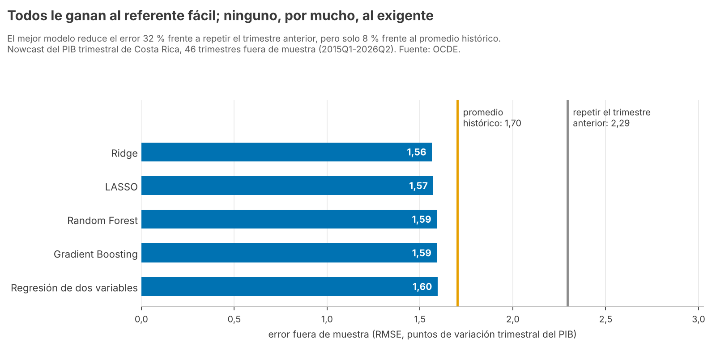
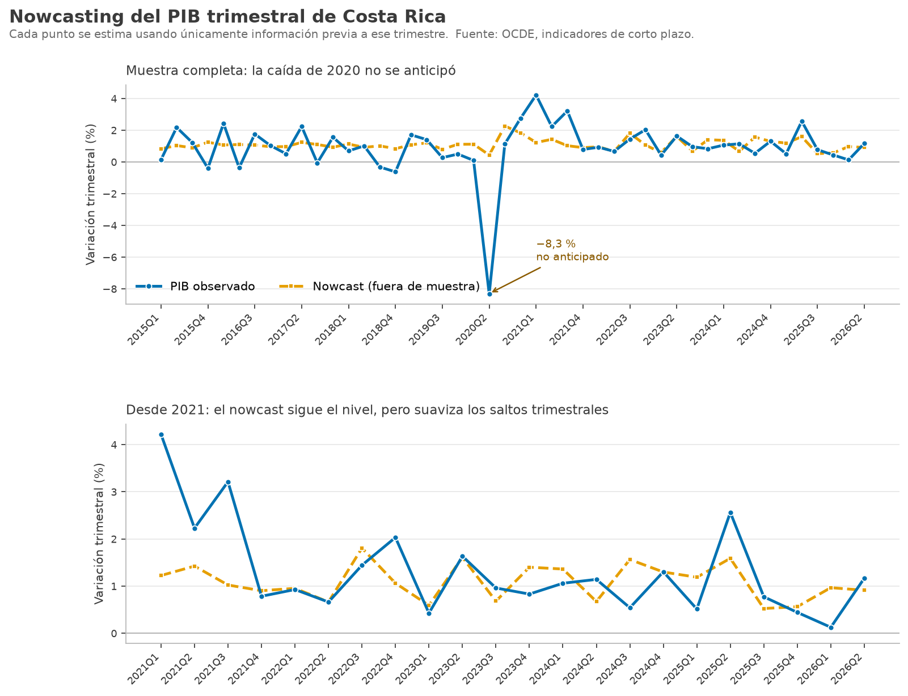

# Nowcasting Costa Rica's quarterly GDP

*[Versión en español](README.md)* ·
**[Interactive dashboard →](https://pabloguerrerocr.github.io/nowcast/)** (in Spanish) pick the period and watch the model's edge change

**Question.** Quarterly GDP is published with a lag of several months. How much of its
growth can be anticipated with the short-term indicators that come out earlier?

**Short answer: not much, and almost nobody reports it that way.** The nowcast cuts the
error by **30.6%** against repeating last quarter, the benchmark everyone publishes, but
only by **6.5%** against the historical mean, which is the one that tells whether the
model adds anything.

| Compared against | Error reduction |
|---|---:|
| Repeating last quarter (the easy benchmark) | **30.6%** |
| Predicting the historical mean (the demanding benchmark) | **6.5%** |



*Chart labels are in Spanish: "repetir el trimestre anterior" is the naive benchmark and
"promedio histórico" the historical mean.*

## Three findings

**1. Against the demanding benchmark, the model adds little.** The improvement is 6.5%
(7.0% excluding 2020) and the in-sample R² is **0.154**. The first version nowcast
year-over-year growth and showed +13.7%, but excluding 2020 it fell to +0.6%: all the
merit was the pandemic. With quarter-over-quarter growth and two benchmarks the result
is less flashy, but it holds.

**2. Machine learning does not change the conclusion.** Ridge, LASSO, Random Forest and
Gradient Boosting, retrained every quarter with time-series cross-validation, cut the
error by up to 13.2% against the historical mean excluding 2020, but **none beats the
two-variable regression with statistical significance** (Diebold-Mariano, p ≥ 0.32).
With 46 quarters, a bigger model is not more signal.

**3. The signal comes from manufacturing, and the model does not see breaks.** All the
predictive power comes from manufacturing production (t = 3.53); exports are not
significant (t = 1.35), a finding in itself for an economy that sees itself as
export-driven. In 2020-Q2 GDP fell **8.3%** and the nowcast predicted **+0.4%**: it does
not anticipate breaks and does not claim to.



## Data

**OECD** short-term indicators for Costa Rica (Key Economic Indicators), through its
public SDMX API with no key. These are the figures the Central Bank of Costa Rica
reports to the organization:

| Series | OECD code | Use |
|---|---|---|
| Quarterly GDP volume, change over the previous quarter | `B1GQ_Q`, `G1` | the target |
| Manufacturing production, monthly change | `PRVM`, activity `C`, `G1` | predictor (quarterly average) |
| Exports, monthly change | `EX`, `G1` | predictor (quarterly average) |

Data from 2000 to 2026-Q2. Raw data is not versioned: `nowcast.py` downloads it if
missing (about 760 KB).

## Method

- **Out-of-sample expanding window:** each quarter since 2015-Q1 is estimated using only
  information up to the previous quarter. The model never sees the future.
- **Two-variable regression**, chosen among 36 specifications; the six-predictor ones
  overfit.
- **Two benchmarks** and root mean squared error (RMSE) as the metric; the
  Diebold-Mariano test says whether a difference is significant.
- **An R replica** ([`r/nowcast.R`](nowcasting-pib/r/nowcast.R), dplyr and ggplot2) that
  GitHub Actions checks against the Python version, quarter by quarter.

Full detail in [`nowcasting-pib/`](nowcasting-pib/README.md) (in Spanish).

## Run it

```bash
git clone https://github.com/pabloguerrerocr/portfolio-data-analytics.git
cd portfolio-data-analytics
pip install -r requirements.txt
cd nowcasting-pib
python nowcast.py               # downloads the OECD data if missing, estimates and plots
python ml.py                    # the machine-learning comparison
python grafico_referentes.py    # the benchmarks chart
```

The first download needs a connection. With fresh OECD data the figures move slightly
because the OECD revises its series; the latest `ml.py` run gives 30.5% and 6.3% for the
regression.

---

## Also in this repository

**[Credit card fraud detection](deteccion-fraude/README.en.md)**: never alerting is
99.87% accurate and saves nothing. Measured in money, alerting on probability ×
amount saves 62.0% of fraud vs 54.5% for the best threshold when a review costs
€15, on 284,807 real transactions with a time-based split.

**[World population 2026](poblacion-mundial/README.en.md)** ([interactive atlas](https://pabloguerrerocr.github.io/atlas/)): Africa holds
19% of the population and accounts for 51% of growth. A map of 234 countries, with
the data validated before it is charted.

---

## Other repositories

| Repository | What it is about |
|---|---|
| [sector-externo-cr-eeuu](https://github.com/pabloguerrerocr/sector-externo-cr-eeuu) | My thesis: the Fed's rate explains 44% of the variance of Costa Rica's reserves at 24 months; the U.S. cycle, 3% |
| [warehouse-sector-externo](https://github.com/pabloguerrerocr/warehouse-sector-externo) | The thesis panel in a DuckDB and dbt star schema, with a data quality engine: it reproduces the original in all 17 comparisons |
| [brecha-espejo-cr](https://github.com/pabloguerrerocr/brecha-espejo-cr) | Costa Rica reports $19.9 bn in exports and its partners report $34.0 bn in imports. Ten years of mirror-statistics gap, analyzed in SQL |
| [comercio-exterior-cr](https://github.com/pabloguerrerocr/comercio-exterior-cr) | Foreign trade concentrated instead of diversifying: Herfindahl from 0.160 to 0.248 between 2010 and 2024 |

---

## Principles I follow

- **The finding comes first**, with a number, in the first lines.
- **Limitations are stated.** A result that does not survive scrutiny is a
  finding, not a failure to hide.
- **Public data only**, with reproducible downloads from the script itself.
- **Raw data is not versioned** — the code fetches it.

---

📍 Costa Rica · Native Spanish, C1 English · [LinkedIn](https://linkedin.com/in/pabloguerrerocr) · pabloguerrerocr@gmail.com
