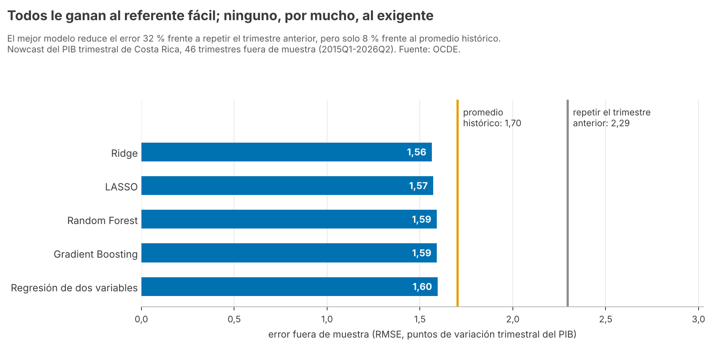
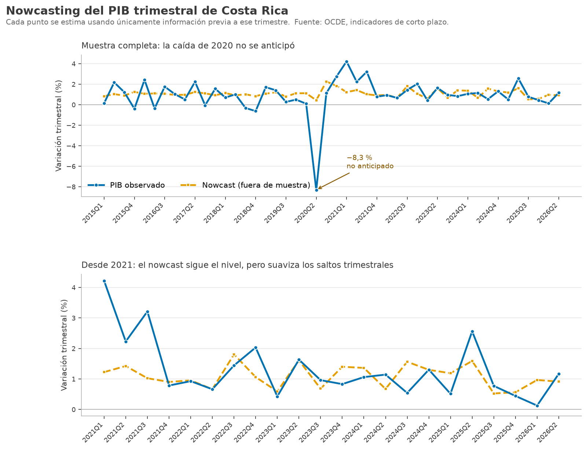

# Nowcasting del PIB trimestral de Costa Rica

*[English version](README.en.md)* ·
**[Tablero interactivo →](https://pabloguerrerocr.github.io/nowcast/)** elegí el período y mirá cómo cambia la ventaja del modelo

**Pregunta.** El PIB trimestral se publica con meses de rezago. ¿Cuánto se puede
anticipar su crecimiento con los indicadores de coyuntura que salen antes?

**Respuesta corta: poco, y casi nadie lo reporta así.** El nowcast reduce el error
**30,6 %** frente a repetir el trimestre anterior, el referente que todos publican,
pero solo **6,5 %** frente al promedio histórico, que es el que dice si el modelo aporta
algo.

| Contra qué se compara | Reducción del error |
|---|---:|
| Repetir el trimestre anterior (el referente fácil) | **30,6 %** |
| Predecir el promedio histórico (el referente exigente) | **6,5 %** |



## Tres hallazgos

**1. Contra el referente exigente, el modelo aporta poco.** La mejora es de 6,5 % (7,0 %
sin 2020) y el R² dentro de muestra es de **0,154**. La primera versión nowcasteaba la
variación interanual y daba +13,7 %, pero al excluir 2020 caía a +0,6 %: todo el mérito
era la pandemia. Con la variación trimestral y dos referentes el resultado es menos
vistoso, pero se sostiene.

**2. El machine learning no cambia la conclusión.** Ridge, LASSO, Random Forest y
Gradient Boosting, reentrenados cada trimestre con validación cruzada de series de
tiempo, reducen el error hasta 13,2 % frente al promedio histórico sin 2020, pero
**ninguno le gana a la regresión de dos variables con significancia estadística**
(Diebold-Mariano, p ≥ 0,32). Con 46 trimestres, más modelo no es más señal.

**3. La señal viene de la manufactura, y el modelo no ve los quiebres.** Toda la
capacidad predictiva sale de la producción manufacturera (t = 3,53); las exportaciones
no son significativas (t = 1,35), un hallazgo en sí mismo para una economía que se
piensa exportadora. En 2020-Q2 el PIB cayó **8,3 %** y el nowcast predijo **+0,4 %**: no
anticipa quiebres y no pretende hacerlo.



## Datos

Indicadores de corto plazo de la **OCDE** para Costa Rica (Key Economic Indicators), por
su API SDMX pública y sin llave. Son las cifras que el BCCR reporta a la organización:

| Serie | Código OCDE | Uso |
|---|---|---|
| PIB trimestral en volumen, variación contra el trimestre anterior | `B1GQ_Q`, `G1` | lo que se predice |
| Producción manufacturera, variación mensual | `PRVM`, actividad `C`, `G1` | predictor (promedio del trimestre) |
| Exportaciones, variación mensual | `EX`, `G1` | predictor (promedio del trimestre) |

Datos de 2000 a 2026-Q2. Los datos crudos no se versionan: `nowcast.py` los baja solo
si faltan (unos 760 KB).

## Método

- **Ventana expansiva fuera de muestra:** cada trimestre desde 2015-Q1 se estima solo
  con información hasta el trimestre anterior. El modelo nunca ve el futuro.
- **Regresión de dos variables**, elegida entre 36 especificaciones; las de seis
  predictores sobreajustaban.
- **Dos referentes** y la raíz del error cuadrático medio (RMSE) como métrica; la
  prueba de Diebold-Mariano dice si una diferencia es significativa.
- **Réplica en R** ([`r/nowcast.R`](nowcasting-pib/r/nowcast.R), dplyr y ggplot2) que
  GitHub Actions verifica contra la versión en Python, trimestre por trimestre.

Detalle completo en [`nowcasting-pib/`](nowcasting-pib/README.md).

## Cómo correrlo

```bash
git clone https://github.com/pabloguerrerocr/portfolio-data-analytics.git
cd portfolio-data-analytics
pip install -r requirements.txt
cd nowcasting-pib
python nowcast.py               # baja los datos de la OCDE si faltan, estima y grafica
python ml.py                    # la comparación con machine learning
python grafico_referentes.py    # el gráfico de los referentes
```

Necesita conexión para la primera descarga. Con datos frescos de la OCDE las cifras se
mueven un poco porque la OCDE revisa sus series; la última corrida de `ml.py` da 30,5 %
y 6,3 % para la regresión.

---

## También en este repositorio

**[Detección de fraude con tarjeta](deteccion-fraude/)**: no alertar nunca acierta el
99,87 % y no ahorra un euro. Midiendo en dinero, alertar por probabilidad × monto
ahorra el 62,0 % del fraude contra 54,5 % del mejor umbral cuando revisar cuesta
€15, con 284.807 transacciones reales y partición temporal.

**[Población mundial 2026](poblacion-mundial/)** ([atlas interactivo](https://pabloguerrerocr.github.io/atlas/)): África tiene el 19 % de
la población y aporta el 51 % del crecimiento. Mapa de 234 países con datos
verificados antes de graficar.

---

## Otros repositorios

| Repositorio | De qué va |
|---|---|
| [sector-externo-cr-eeuu](https://github.com/pabloguerrerocr/sector-externo-cr-eeuu) | Mi trabajo final de graduación: la tasa de la Fed explica el 44 % de la varianza de las reservas de Costa Rica a 24 meses; el ciclo de EE. UU., el 3 % |
| [warehouse-sector-externo](https://github.com/pabloguerrerocr/warehouse-sector-externo) | El panel del trabajo de graduación en un esquema estrella de DuckDB y dbt, con motor de calidad: reproduce el original en las 17 comparaciones |
| [brecha-espejo-cr](https://github.com/pabloguerrerocr/brecha-espejo-cr) | Costa Rica declara exportar $19,9 mm y sus socios declaran importar $34,0 mm. Diez años de brecha espejo, analizados en SQL |
| [comercio-exterior-cr](https://github.com/pabloguerrerocr/comercio-exterior-cr) | El comercio exterior se concentró en vez de diversificarse: Herfindahl de 0,160 a 0,248 entre 2010 y 2024 |

---

## Criterios que sigo

- **El hallazgo va primero**, con número, en las primeras líneas.
- **Las limitaciones se declaran.** Un resultado que no sobrevive al escrutinio es un
  hallazgo, no un fracaso que esconder.
- **Datos públicos únicamente**, con descarga reproducible desde el propio script.
- **Los datos crudos no se versionan** — el código los obtiene solo.

---

📍 Costa Rica · Español nativo, inglés C1 · [LinkedIn](https://linkedin.com/in/pabloguerrerocr) · pabloguerrerocr@gmail.com
